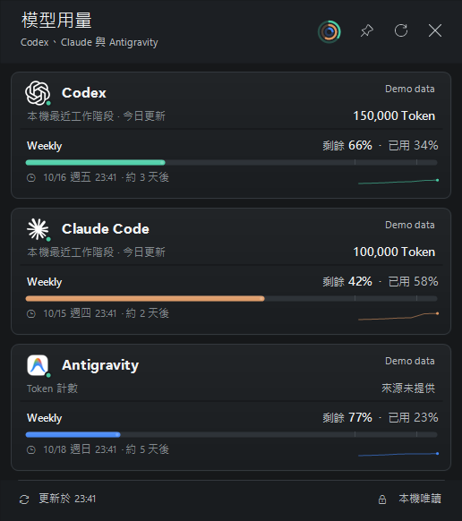
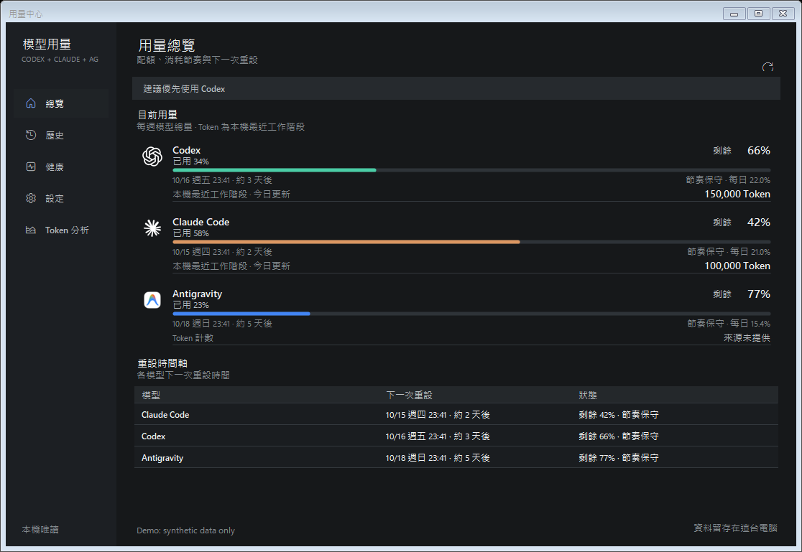
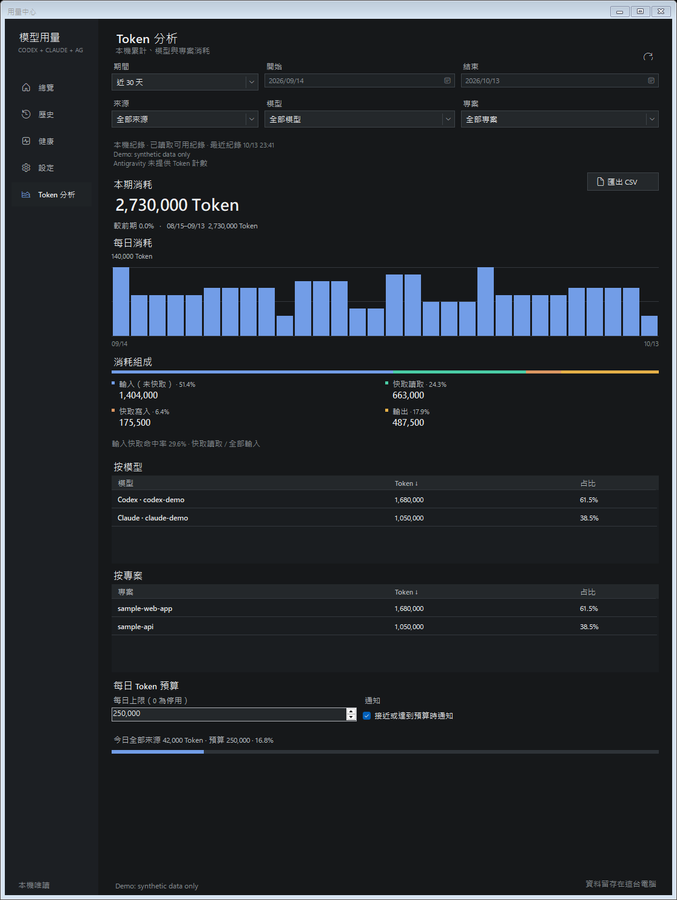

# Codex + Claude + Antigravity 用量

這是一個 Windows 系統匣桌面插件，同一個彈出視窗顯示 Codex、Claude Code 與 Google Antigravity 的方案總用量、剩餘比例與重設時間。它不是瀏覽器網頁，也不會保存登入憑證。

下方畫面使用合成示範資料，不代表任何真實帳號的用量。







## 功能

- Codex：從官方 `codex app-server` 讀取限額；無法連線時改讀本機工作階段紀錄。
- Claude Code：從 Claude Desktop 官方用量歷史快取讀取百分比，並以 Claude Code `statusLine` 回報補上重設時間。
- Claude 同步：監聽官方用量歷史與 Code 狀態列回報檔案，異動後自動排程刷新；使用去抖與限頻避免連續寫入造成重複請求，原本的定時輪詢仍保留作後備。這是加快接收官方新樣本，不代表伺服器每秒提供新額度。
- Token：另從本機 Codex 最近工作階段與 Claude Code 最近主工作階段紀錄讀取輸入、輸出與合計 Token。快顯卡片與用量中心以獨立資訊列呈現精確總數及最後紀錄日期，滑過可看輸入（含快取）／輸出明細。這是單一工作階段的本機可觀測值，不是方案額度或今日／本週總量；Codex 可能選到最近有有效用量的子代理工作階段，Claude Code 則不含子代理。兩者都不含同帳號其他裝置的用量。Antigravity 目前未提供可驗證的 Token 數。
- 「Token 分析」集中檢視本機近 90 天紀錄：今日、本週（週一開始）、本月、近 30 天與自訂期間，並依來源、模型、專案篩選。提供每日趨勢、前期比較、模型與專案排序，以及未快取輸入、快取讀取、快取寫入、輸出四種消耗組成。
- Token 分析整合主工作階段與子代理並去重；Codex 以累計差分計算每筆消耗，Claude 依訊息識別值去重。與快顯的「最近工作階段」數字不同，分析頁是所選期間的本機彙總。
- Codex 子代理紀錄內可能再次包含父對話的 `session_meta`，分析器保留檔案第一筆工作階段身分，避免把父／子累計串流混在一起、重複計算跳升量。
- 首次建立 Token 索引時採分批背景處理，進度保存在本機，下一次啟動可繼續。索引中、未完成紀錄或無法讀取時會標示部分資料；前期比較及今日預算各自要求對應日期範圍已確認完整，不用舊異常資料推算通知。
- 分析頁可設定每日 Token 預算（0 為停用），於達到 80%／100% 時各通知一次，遵守通知總開關及免打擾時段，重啟後不重複提醒。預算計算本機今日所有來源，與上方報表篩選無關。
- 「匯出 CSV」匯出分析頁目前篩選後的每日明細，包含模型、專案簡稱與四類 Token。採 UTF-8 BOM 供 Excel 使用，並防護文字欄位被當成公式。專案名稱不是匿名資料，分享前請先確認內容。
- 用量更新整體失敗時依 5、15、30、60、120、300 秒退避重試，成功後恢復一般更新頻率；部分來源失敗時持續定期重試，保留最近成功讀取時間。小工具的可恢復繪圖例外會延後重建視窗，並限制重建頻率。
- Antigravity：自動偵測本機 Antigravity 語言伺服器的動態通訊埠與 CSRF 憑證，以 Connect-RPC 讀取官方四條限額 —— Gemini 每週／5 小時、第三方模型（Claude Opus/Sonnet、GPT-OSS）每週／5 小時。連線參數在首次成功後快取於記憶體；記錄檔中的憑證與目前執行個體不符時，會從監聽埠的擁有程序重新配對。
- 預設「模型總量」模式只顯示 Codex 與 Claude Code 的每週總用量；需要時可從系統匣選單暫時展開短期視窗。
- 「用量中心」採 Windows 11 深色工作區與左側導覽，整合總覽、週期歷史、資料健康與設定；深色自繪資料表、語意狀態色與一致切換控制項可在高 DPI 下快速掃讀。總覽會依週期經過比例計算消耗節奏及每日可用額度，並建議目前較適合使用的模型。
- 重設時間軸逐條列出每一項限額的下一次重設（Antigravity 的四條額度各自成列），依時刻排序；週期歷史保存模型總量峰值、每日平均與相對上期變化，支援 JSON／CSV 匯出及 1、7、14、30 天保留期限。
- 資料健康頁顯示來源、新鮮度與 Claude 橋接狀態；可複製去除憑證、路徑、IP、Email 與不透明識別值的診斷報告，並安全修復本程式管理的 Claude Code 橋接。既有自訂 `statusLine` 一律保留。
- 通知可分別控制高用量、預計耗盡、額度重設及 Codex／Claude Code／Antigravity，並支援跨午夜免打擾時段。門檻通知取該供應商目前最吃緊的一條限額，耗盡預警取最早用罄的一條，每個供應商仍只發一則。
- 全域快捷鍵：`Win+Alt+U` 開關用量面板，`Win+Alt+R` 立即更新；若單一組合已被其他程式占用，會自動改用對應的 `Win+Alt+Shift+U/R` 並提示。
- 設定頁可清除本程式建立的趨勢、週期、重設與錯誤紀錄；不會刪除偏好設定、Claude Code 設定或官方快取。
- 每 60 秒背景更新，達 80% 與 95% 時發出 Windows 通知。
- 系統匣圖示是三環用量儀表：外環 Codex、中環 Claude、內環 Antigravity，優先依各自的每週模型總使用量填充並在 80% / 95% 轉為警示色；同一供應商有多條每週限額時取已用比例最高者，沒有每週資料時才回退第一個可用視窗。
- 供應商狀態點反映資料新鮮度：60 分鐘內為綠、偏舊或時間未知為橘、不可用為灰。
- 左鍵點系統匣圖示開啟；右鍵可立即更新、切換通知、切換桌面小工具、切換開機啟動或結束。右鍵選單採 Win11 語彙：DWM 圓角、圓角懸停高亮、Fluent 勾號；小工具選單頂部另有即時用量摘要列（迷你雙環＋兩組剩餘 %），並提供立即更新與重設位置。
- 桌面小工具：平常收合為一顆雙環用量圓點（外環 Codex、內環 Claude，按下即有按壓回饋），單擊以液態形變展開為與圓同高的單行膠囊，再單擊即收攏；形變中點擊會從當前進度平滑反向，快速連點也不跳變。膠囊左端保留雙環原位，右側如抽屜拉出兩組「官方品牌圖示（與資訊堆疊同高）＋品牌色每週剩餘百分比＋等寬微型進度條」（條與數字對齊、條長為已用比例，80% 轉黃、95% 轉紅）；形變只走水平單軸（展開 280ms 過衝回彈、收合 220ms 乾脆、內容獨立曲線淡入），以 UpdateLayeredWindow 逐幀原子合成並以 DwmFlush 鎖定 DWM 合成節拍，與系統動畫同一路徑。展開方向會感知位置：圓點在螢幕左半向右開啟、右半向左開啟（雙環永遠錨在原位端）。滑鼠離開約 1.5 秒自動縮回，右鍵「固定展開」可常駐膠囊（固定時單擊不收）。從小工具開啟詳細面板一律就地呈現、不會跑到螢幕右下角：雙擊（圓點或膠囊皆可）以「液滴墜落」開啟 — 一滴自錨定端圓底部帶頸擠出、斷頸後成淚滴（含液面高光與滯後尾滴）重力加速墜落，落地壓扁，落點處面板以水波圓形揭示展開；右鍵「開啟用量面板」則直接在小工具下方水波揭示。系統匣圖示開啟的面板維持顯示於系統匣附近。可拖曳擺放並記住位置；不搶焦點、不出現在工作列與 Alt+Tab，雙擊開主面板，右鍵可切換保持最上層或隱藏。
- 介面優先使用已安裝 Codex 與 Claude Desktop 的官方圖示，並以內嵌官方圖示作為後備。
- 使用 Windows Fluent 系統圖示，支援 Tab 導覽、`Esc` 關閉與 `Ctrl+R` 更新。
- Windows 11 採用 DWM 原生圓角、系統陰影與一致邊框色；Windows 10 自動回退為 Region 圓角與傳統視窗陰影。
- 使用 Segoe UI Variable 字型與 Per-Monitor V2 DPI，在不同縮放比例的螢幕上會重新計算排版。
- 主面板採卡片式版面：Codex、Claude 與 Antigravity 各為一張圓角微漸層卡片（含低對比邊框與卡內髮絲分隔線），額度行、趨勢圖、進度條與懸停高亮一律以卡內縮排對齊，面板高度依卡片實高逐段累加；優先顯示剩餘額度，模型名稱、視窗週期與資料來源可快速掃讀。每張卡最多完整呈現四列額度（Antigravity 的四條限額），並依目前螢幕工作區高度自動收斂 —— 空間不足時各卡輪流讓出較次要的額度列，永遠保留每個供應商的代表限額，面板不會被螢幕邊緣裁切。滑過額度行的提示會補上該限額涵蓋的模型。
- 用量中心總覽採無左右框線的資訊列，只保留內容底部分隔；左側導覽以選中底色與原生圖示強調目前頁面，不使用側邊色線。時間軸只為實際表頭與資料列上色，最大化時不會以空白表格面填滿畫面。
- 進度條含 80% / 95% 警戒刻度與亮度漸層；用量達 80% 轉為警示黃、95% 轉為警示紅，數值文字同步變色。
- 每週額度提供 7 天用量趨勢迷你圖與耗盡預警：依近期使用速度預測用罄時刻，早於重設時間時於面板顯示「約 … 用罄」並發出 Windows 通知。超過 60 分鐘的舊資料仍可顯示作參考，但不參與即時耗盡預測或通知。Claude 使用 Desktop 用量歷史（5 小時視窗亦附短窗趨勢圖）；Codex 由本機快照記錄（10 分鐘去抖、保留 14 天）累積趨勢；Antigravity 的四條限額各自累積一條序列（每週用 7 天視窗、5 小時用短窗），預測若落在本視窗重設之後即視為無意義而不顯示。
- 面板標頭有迷你雙環儀表與釘選按鈕：釘住後點擊面板外部不會關閉（Esc 仍可）；滑過重設時間可見絕對重設時刻，滑過額度行有柔和懸停高亮，`Ctrl+C` 可複製用量摘要。面板開啟時趨勢線以描線動畫進場，進度條前緣帶液面光點。小工具右鍵選單提供不透明度調整（100–75%，記住設定）。
- 提供 160ms 視窗進場、360ms SmoothStep 用量過渡、720ms 刷新旋轉與完成回饋；Windows 關閉用戶端區域動畫或開啟高對比時會自動停用。
- Codex、Claude 與 Antigravity 資料擷取在背景並行執行，JSON 解析器按工作執行緒隔離，不會互相覆寫或阻塞介面動畫；已捕捉的更新錯誤會寫入 `%LOCALAPPDATA%\CodexClaudeUsage\error.log`。
- Codex 重置偵測器只監看官方 `app-server` 額度窗口，依 stable ID、真實用量下降與下一個重置邊界前進來確認重置；右鍵選單可查看最近一次重置，通知開啟時會在重置發生時送出 Windows 提示。
- 額度百分比仍只讀取帳號模型總用量；Token 由本機紀錄統計，不建立裝置 ID、不讀取 IP，也不統計或同步不同裝置的 Token。
- 方案資料均以唯讀方式取得；Claude 橋接器只落地 `rate_limits`，Codex 重置狀態只保存最少量的 bucket 基線與最近事件，不保存提示詞、回覆、登入憑證、裝置 ID 或 IP。

## 安裝

在 PowerShell 執行：

```powershell
git clone https://github.com/Wang-YuChen-1999/codex-claude-usage.git
Set-Location .\codex-claude-usage
.\install.ps1
```

安裝位置為 `%LOCALAPPDATA%\Programs\CodexClaudeUsage`，並建立「Codex + Claude 用量」開始功能表捷徑。安裝器會在沒有既有 Claude Code `statusLine` 時加入橋接設定；若已有自訂狀態列，則保留原設定，不會覆寫。

需要 Codex 官方即時額度時，請先將 `config.json` 的 `codexExecutable` 設為本機支援 `app-server` 的 Codex CLI 執行檔路徑；公開設定不包含開發者的私人路徑。未設定時仍可使用本機工作階段後備資料，但不會產生官方即時趨勢或重置事件。

解除安裝：

```powershell
& "$env:LOCALAPPDATA\Programs\CodexClaudeUsage\uninstall.ps1"
```

## 建置與驗證

```powershell
.\build.ps1 -Clean
.\tests\test_antigravity_source.ps1
.\tests\test_sources.ps1
.\tests\test_tray_summary.ps1
.\tests\test_bridge.ps1
.\tests\test_claude_freshness.ps1
.\tests\test_claude_live_monitor.ps1
.\tests\test_claude_reset_estimate.ps1
.\tests\test_reset_labels.ps1
.\tests\test_codex_fallback.ps1
.\tests\test_codex_reset_detector.ps1
.\tests\test_cycle_history.ps1
.\tests\test_diagnostics.ps1
.\tests\test_display_filter.ps1
.\tests\test_droplet_completion.ps1
.\tests\test_widget_paint.ps1
.\tests\test_widget_dpi.ps1
.\tests\test_json_concurrency.ps1
.\tests\test_local_tokens.ps1
.\tests\test_token_presentation.ps1
.\tests\test_token_analytics.ps1
.\tests\test_token_analytics_layout.ps1
.\tests\test_token_budget_export.ps1
.\tests\test_usage_recovery.ps1
.\tests\test_motion_settings.ps1
.\tests\test_notification_freshness.ps1
.\tests\test_usage_insights.ps1
.\tests\test_usage_projection.ps1
.\tests\test_user_preferences.ps1
.\tests\test_popup_layout.ps1
.\tests\test_tray_commands.ps1
.\tests\test_usage_center_layout.ps1
```

編譯使用 Windows 內建的 .NET Framework 4.8 C# 編譯器，不需要額外安裝 Node.js、Python 或 .NET SDK。

`config.json` 預設不指定 Codex 路徑。程式會先使用有效的 `codexExecutable`，再檢查程式同目錄的 `codex.exe`；兩者皆不可用時改讀本機工作階段紀錄，不會搜尋 PATH 或其他安裝目錄。`test_usage_projection.ps1` 的 Codex 部分需要可用的官方 app-server，`test_antigravity_source.ps1` 需要 Antigravity 本機語言伺服器正在執行且可連線；這些前置條件未滿足時，整合測試會失敗。純解析與排版測試使用暫存合成資料。

重新產生公開示範畫面（不查詢帳號用量）：

```powershell
powershell.exe -NoProfile -ExecutionPolicy Bypass -File .\scripts\render-demo.ps1
```

## 設定

[`config.json`](./config.json) 可調整：

| 欄位 | 用途 |
| --- | --- |
| `refreshSeconds` | 更新間隔，最少 15 秒 |
| `warningPercent` | 一般警示門檻 |
| `criticalPercent` | 高風險警示門檻 |
| `notificationsEnabled` | 是否啟用 Windows 通知 |
| `codexExecutable` | 支援 `app-server` 的 `codex.exe` 路徑 |

介面偏好保存在 `%LOCALAPPDATA%\CodexClaudeUsage\preferences.json`，包含總量模式、通知類型、免打擾時段、歷史保留期限、每日 Token 預算與全域快捷鍵開關；不含帳號或使用內容。

## 資料來源與限制

- Codex 官方 app-server：[App Server](https://learn.chatgpt.com/docs/app-server)。
- Antigravity 配額來自本機語言伺服器的 `RetrieveUserQuotaSummary` 與 `GetUserStatus`（`http://127.0.0.1:<動態埠>`，僅迴圈位址、不走系統 Proxy）。初次連線可讀取 `%APPDATA%\Antigravity\logs`；若記錄檔配對失效，會查詢目前語言伺服器程序及其本機監聽埠。CSRF 只留在記憶體，不寫入任何檔案，診斷報告亦一律去除。方案層級（tier）快取 30 分鐘，省去每輪一次 RPC。
- Antigravity 額度尚未使用且重設點接近「採樣時間加完整視窗長度」時，介面顯示「尚未開始計時」，不把移動的時間上界當成固定倒數；滑鼠提示保留來源回報的時間上界。若官方回報固定重設點，即使已用 0% 仍保留該期限。
- 重設標籤包含日期、星期與時間，跨年度時另顯示年份。時間已到但來源尚未確認時顯示「等待同步」，不會自行將用量歸零；推估值會明示「推估」。
- 用量中心與快顯面板共用相同重設語意。尚未開始計時、期限已到或時間未知時，不推算每日可用額度，也不以預設零值參與節奏比較與模型建議。
- 用量中心總覽在視窗高度不足時可垂直捲動，三個供應商與重設時間軸都能查看。
- Antigravity 未執行時改用上一次成功的本地快取（`%LOCALAPPDATA%\CodexClaudeUsage\antigravity-status.json`），並以本機歷史重建趨勢線：超過 6 小時標示「Antigravity 未執行」，超過 72 小時即視為失效、不再冒充可用資料。
- Claude Code 官方狀態列輸入格式：[Status line](https://code.claude.com/docs/en/statusline)。
- Claude Code 方案與用量說明：[Costs and usage](https://code.claude.com/docs/en/costs)。
- Claude Desktop 快取本身沒有重設時間；沒有狀態列資料時，改由 Desktop 用量歷史推算 — 5 小時視窗顯示「最晚於何時重設」的上界、每週視窗以上次重設加 7 天週期外推，介面會標示「推估」。Claude Code 狀態列一旦回報官方重設時間即覆蓋推算值。
- Claude 最後已知用量會持續顯示供參考；快照超過 60 分鐘時改標示「等待 Claude 同步」，不再顯示容易誤解的「資料過期」或以 0.0% 假裝即時節奏。這類舊快照不參與建議、通知、節奏與耗盡預測。
- Claude Desktop 的設定頁刷新與系統匣歷史同步是不同流程。若官方用量頁已變動但本工具仍顯示舊快取，可對 Claude 官方系統匣圖示按右鍵，觸發其用量抓取；無須傳送模型訊息。2026-10-10 核對的本機 Desktop 版本為 2.31226.0.0，官方仍可能節流歷史寫入或暫停閒置輪詢。本工具不改寫官方資料，也不在背景反覆操作系統匣。
- Claude Code 的 `rate_limits` 必須由實際 API 回應提供，單純啟動 CLI 或重跑狀態列腳本不會產生新的真實用量。只有重設時間或空內容的橋接檔案，不會把舊百分比的時間戳更新為現在。
- Claude 橋接顯示「已設定，等待 Claude Code 回報」代表 `statusLine` 腳本已安裝但尚未收到近期限制資料；只有取得有效回報後才顯示「已就緒」。
- 狀態列橋接資料超過 24 小時即自動失效；Desktop 與 Code 同時有資料時會以時間戳決定百分比來源。橋接只提供重設時間而未提供百分比時，不會把 Desktop 用量誤覆寫成 0%。
- 供應商快照超過 60 分鐘、時間未知或明顯來自未來時，不會觸發門檻或耗盡通知；資料恢復後會重新依目前狀態判定。
- Codex 重置事件只由新鮮的官方 `app-server` 快照確認；兩次觀測相隔超過 20 分鐘時只重建基線，不補發可能已過時的通知。最小狀態保存在 `%LOCALAPPDATA%\CodexClaudeUsage\codex-reset-state.json`。
- Codex 與 Claude 官方方案百分比都是帳號全域值；本工具刻意不記錄或推算同帳號在不同 IP／裝置上的個別用量。
- 快顯與用量中心總覽的 Token 數仍為最近單一工作階段合計。讀取器先依檔案修改時間選取最多 16 個候選檔案，再比較有效 Token 事件的時間戳，不把檔案修改時間當成用量發生時間；超過 20,000 個紀錄檔時停止掃描。非今日的紀錄明示「本機歷史工作階段」，Token 日期與額度更新日期各自獨立。
- Token 讀取採開檔時長度快照，允許其他程式繼續追加，不因檔案持續增長而退回舊工作階段；未完成的末行等下次更新再讀。Codex 只解析檔尾最多 4 MiB，Claude 單檔上限 64 MiB；有效紀錄必須有可解析的事件時間戳。依檔案長度與修改時間快取摘要，未變動檔案不重複解析。
- Claude 的系統合成訊息與 API 錯誤訊息不計入，同一訊息的較小片段不覆蓋較完整用量；若最近工作階段只有無效訊息，會讀取較早的有效紀錄並顯示其日期。輸入（含快取）、輸出及更新時刻可由滑鼠提示、無障礙描述或 `--snapshot` 查看。
- Token 分析涵蓋近 90 天可觀測紀錄，日期依電腦本機時區歸類；未快取輸入不含快取讀／寫，四類相加為總量。缺少模型、專案或歷史基準時會明示未知／部分資料。Antigravity 不提供 Token，因此不加入 Token 統計或預算。
- `%LOCALAPPDATA%\CodexClaudeUsage\token-analytics-index.bin` 保存可續讀索引：雜湊後的檔案／工作階段／訊息識別值、日期、模型、專案末層名稱與短雜湊、Token 數及讀取進度。沒有提示詞、回覆、憑證或完整專案路徑；`token-budget-state.json` 僅記錄每日預算通知門檻。索引毀損時會從本機紀錄重新建立。這些統計無法代表官方帳號的跨裝置總消耗。
- 週期歷史只保存供應商名稱、週期時間與模型總量百分比；週期匯出與診斷報告不包含提示詞、回覆、Token、登入憑證、裝置 ID、IP 或帳號識別資訊。手動執行 `--snapshot` 時則會輸出本機最近工作階段的 Token 數值，請自行保管該輸出檔。
- Codex/ChatGPT 插件 UI 只能呈現在對話內，不能修改 Codex Desktop 的帳號選單，因此本工具採用獨立系統匣介面。

## 公開版本範圍

本倉庫包含桌面程式原始碼、測試、品牌圖示、建置與安裝腳本。真實用量快照、工作對話、個人設定、登入憑證及桌面擷取不納入版本控制。`dist/` 為建置產物，可由原始碼重新產生；除錯符號可能包含建置機路徑，故不公開。

## 貢獻

歡迎透過 Issue 回報問題或提出建議，也歡迎送出 Pull Request。修改程式後請先執行 `.\build.ps1 -Clean` 與 `tests\` 內的測試腳本。

## 授權

本專案程式碼沿用 [GNU General Public License v3.0](./LICENSE)。品牌圖示的權利說明另見 [assets/README.md](./assets/README.md)。

Codex 與 ChatGPT 為 OpenAI 的商標，Claude 為 Anthropic 的商標，Antigravity 與 Gemini 為 Google 的商標。本專案與上述公司無任何隸屬或背書關係；Antigravity 本機語言伺服器介面並非公開文件化的 API，未來版本可能變動。
